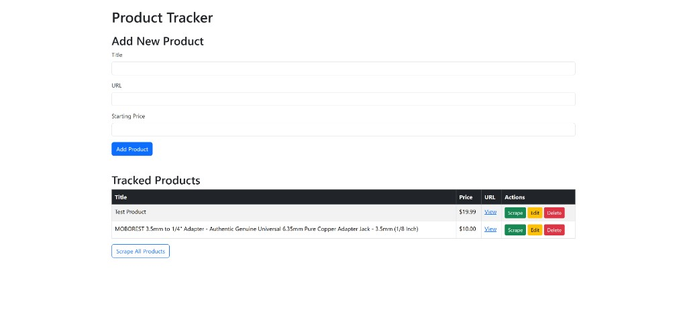

🛒 Amazon Price Tracker
Track Amazon product prices and receive email alerts when they drop below your target. Built with Flask, Playwright, and a dynamic dashboard for real-time management.



🚀 Features
- ✅ Price Monitoring via Playwright (headless browser scraping)
- 📬 Email Alerts using Gmail SMTP and .env credentials
- 🧠 Dashboard UI with inline editing, deletion, and live feedback
- 🗂️ JSON-based product management for easy persistence
- 🔒 Flask-WTF ready with secure form handling and flash messages

🧰 Tech Stack
| Layer | Tools Used | 
| Backend | Flask, Playwright, asyncio | 
| Frontend | HTML, JavaScript, Flask templates | 
| Email | Gmail SMTP via smtplib | 
| Storage | products.json | 
| Config | .env + python-dotenv | 


⚙️ Setup Instructions
1. Clone the repo
git clone https://github.com/yourusername/amazon-price-tracker.git
cd amazon-price-tracker


2. Install dependencies
pip install -r requirements.txt


3. Create .env file
EMAIL_ADDRESS=your@gmail.com
EMAIL_PASSWORD=your_app_password
SMTP_SERVER=smtp.gmail.com
SMTP_PORT=587


⚠️ Use a Gmail App Password, not your regular password. Generate one here

4. Launch the app
python app.py


Visit http://localhost:5000 in your browser.

📦 Usage
- Add a product name, Amazon URL, and target price
- Click Check Price
- If the current price is below your target, you’ll receive an email alert
- Use the dropdown to edit or delete existing products

🧪 Testing
- Visit /send-test-email to confirm email setup
- Visit /health to verify .env and products.json integrity

🛠️ Future Enhancements
- 🕒 Scheduled price checks via background tasks
- 📈 Price history tracking
- 🧪 Unit tests and CI integration
- 🔐 OAuth support for Gmail

🙌 Credits
Built by Josh — a creative, uncompromising builder who values polish, clarity, and outcome-driven tools.

Want me to generate a matching requirements.txt or a badge-filled GitHub header next?
🧰 Tech Stack
| Layer | Tools Used | 
| Backend | Flask, Playwright, asyncio | 
| Frontend | HTML, JavaScript, Flask templates | 
| Email | Gmail SMTP via smtplib | 
| Storage | products.json | 
| Config | .env + python-dotenv | 


#Clone the repo
```git clone https://github.com/yourusername/amazon-price-tracker.git
cd amazon-price-tracker
```
#Install dependencies
```
pip install -r requirements.txt
```
#Create .env fil
```
EMAIL_ADDRESS=your@gmail.com
EMAIL_PASSWORD=your_app_password
SMTP_SERVER=smtp.gmail.com
SMTP_PORT=587
```
#⚠️ Use a Gmail App Password, not your regular password. 
```
Generate one here https://myaccount.google.com/apppasswords
```
#Launch the app
```
python app.py
```
#Visit in your browser.
```
http://localhost:5000
```

📦 Usage
- Add a product name, Amazon URL, and target price
- Click Check Price
- If the current price is below your target, you’ll receive an email alert
- Use the dropdown to edit or delete existing products


